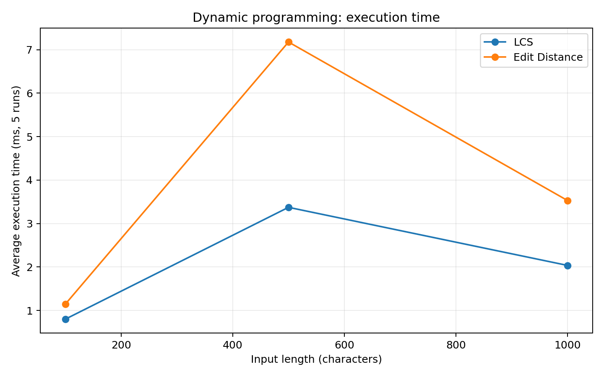
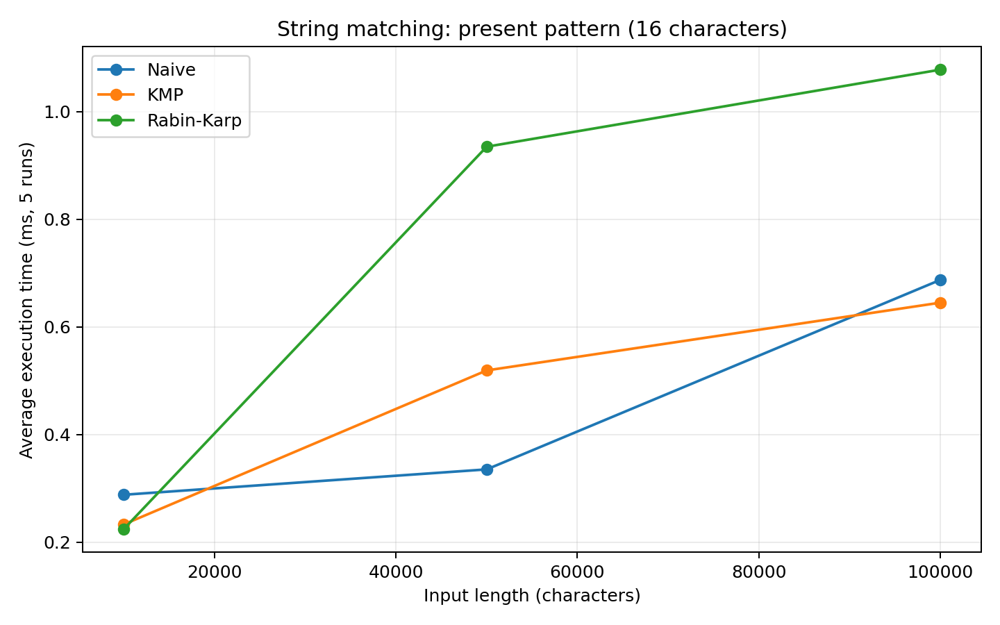
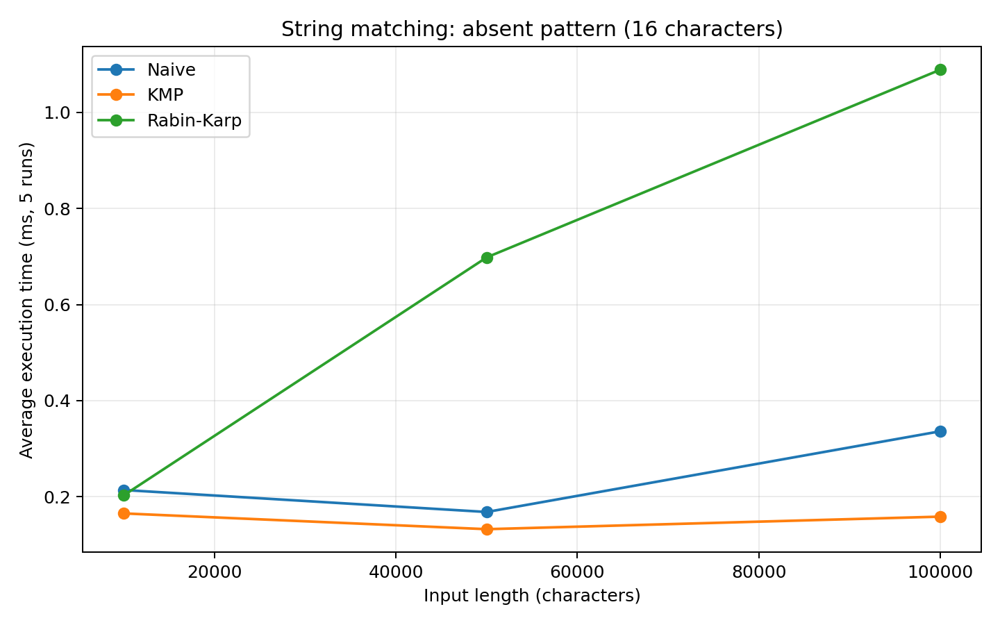
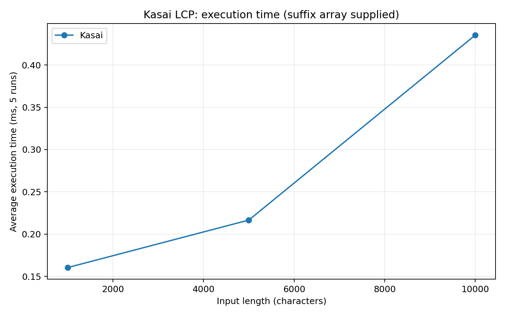

# Assignment 4 — Text Analysis: Dynamic Programming and String Algorithms

Java application implementing and experimentally comparing **five required algorithms**: Longest Common Subsequence (LCS), Levenshtein edit distance, Naive string matching, Knuth–Morris–Pratt (KMP), Rabin–Karp, and additionally **Kasai’s algorithm** for the longest-common-prefix (LCP) array (six named implementations in total). This README is the full assignment report, not a separate PDF.

## 1. Problem and algorithm overview

- **LCS:** length of the longest sequence of characters occurring in both strings in order, not necessarily contiguously.
- **Edit Distance:** minimum number of unit-cost insertions, deletions, and substitutions converting one string to another.
- **Naive matching:** try the pattern at every possible alignment in the text.
- **KMP:** use a longest proper prefix/suffix (LPS) table to avoid rechecking matched prefixes after mismatch.
- **Rabin–Karp:** compare rolling polynomial hash values, then check actual characters for hash matches.
- **Kasai:** given a **precomputed** suffix array sorted lexicographically, compute common-prefix lengths of adjacent sorted suffixes in linear time.

## 2. Files and running the project

```text
Assignment4_TextAnalysis/
├── src/assignment4/
│   ├── Algorithms.java    # All six algorithms + suffix-array test helper
│   ├── Tests.java         # Deterministic and randomized correctness tests
│   ├── Benchmark.java     # Fixed-seed 5-run benchmark and CSV writer
│   └── Main.java          # Command-line entry point
├── results/
│   ├── dp.csv
│   ├── matching.csv
│   └── kasai.csv
├── plots/
│   ├── dp_times.png
│   ├── matching_present.png
│   ├── matching_absent.png
│   └── kasai_times.png
├── plot_results.py
├── run.sh
└── README.md
```

Requirements: **JDK 17 or newer**. Graph regeneration additionally requires Python 3 and `matplotlib`. Java execution uses **no third-party libraries**. Run from the project root:

```bash
# macOS / Linux (or Git Bash on Windows)
./run.sh test
./run.sh demo
./run.sh benchmark
python3 plot_results.py
```

For Windows PowerShell or any platform, use the equivalent manual commands:

```text
javac -encoding UTF-8 -d out src/assignment4/*.java
java -cp out assignment4.Main test
java -cp out assignment4.Main demo
java -cp out assignment4.Main benchmark
python plot_results.py
```

The `benchmark` command overwrites the CSVs; `plot_results.py` updates plots from those CSVs. Since measured times depend on hardware, a new run will not necessarily match this repository's sample results.

## 3. Implementation decisions and assumptions

- Strings use Java `char` (UTF-16 code units), not Unicode grapheme clusters. Experimental data is **ASCII alphabet `ABCD`**, uniformly sampled with `java.util.Random`, fixed seed **20261108**. The absent search pattern uses `Z`, outside that alphabet.
- Both DP algorithms allocate a full `(m + 1) × (n + 1)` integer table; the full-table implementation directly demonstrates the required recurrence and base cases rather than using a rolling-row optimization.
- All match indices are **0-based**, sorted ascending; overlapping occurrences are included.
- An **empty pattern matches every boundary**: `0` through `text.length()` inclusive, including `[0]` for an empty text. A nonempty pattern cannot match an empty text.
- KMP's LPS table is computed from scratch per search; search comparison counts **exclude LPS preprocessing** but timings **include it**.
- Rabin–Karp hashes `char` codes with base **256** and prime modulus **1,000,000,007**, using Java `long` arithmetic; every matching hash is verified character-by-character, so collisions cannot cause false-positive matches. Comparison counts reflect these verifications; hash arithmetic is not counted as character comparisons.
- The Kasai input suffix array must be a permutation of `0..n−1` sorted lexicographically. The implementation checks its permutation but assumes the supplied ordering is correct. `suffixArrayForTesting` is a simple sorting helper used only to prepare tests and benchmarking inputs, **outside Kasai's timed region**; suffix-array construction is not part of the required algorithm.
- All experiments use the same data across alternative algorithms at each input size. No file operations, data generation, plotting, or console output occur inside timed regions.

## 4. Dynamic-programming recurrences and correctness

**LCS.** Let `L[i][j]` be the LCS length of the first `i` characters of `a` and first `j` of `b`. Base cases: `L[i][0]=L[0][j]=0`.

```text
L[i][j] = L[i-1][j-1] + 1                 if a[i-1] == b[j-1]
          max(L[i-1][j], L[i][j-1])       otherwise
```

*Why correct:* matching final characters can extend an optimal subsequence of the prefixes by one. If the final characters disagree, a common subsequence cannot use both final characters, so at least one must be omitted; taking the maximum of those optimal subproblems covers all possibilities. Induction on `i+j` proves the recurrence.

**Levenshtein.** Let `D[i][j]` be the minimum edit cost for converting prefix `a[0..i)` into `b[0..j)`. Base cases: `D[i][0]=i`, `D[0][j]=j`.

```text
cost = 0 if a[i-1] == b[j-1], else 1
D[i][j] = min(D[i-1][j] + 1,                # delete
              D[i][j-1] + 1,                # insert
              D[i-1][j-1] + cost)           # match/substitute
```

*Why correct:* every final edit sequence either deletes the last source character, inserts the last target character, or matches/substitutes the final pair. Each case leaves exactly the stated shorter-prefix optimal subproblem. The minimum therefore gives the optimum by induction.

## 5. Complexity analysis

Let `m` and `n` be lengths of the two input strings for DP; for matching, `n` is text length and `m` is pattern length. For Kasai, `n` is string length. Auxiliary space excludes immutable inputs, but includes DP matrices, match-output lists, and Kasai's returned LCP array. `z` denotes the number of reported matches; for empty patterns `z=n+1`.

| Algorithm | Main operation / recurrence | Best-case time | Worst-case time | Auxiliary space | Reason |
| --- | --- | --- | --- | --- | --- |
| LCS (table DP) | `L[i][j]` from diagonal or max of top/left | Θ(mn) | Θ(mn) | Θ(mn) | All `m*n` states evaluated, whole matrix stored (even if one input is empty, matrix initialization uses O(m+n+1)). |
| Edit Distance (table DP) | Minimum of delete/insert/substitute | Θ(mn) for nonempty lengths | Θ(mn) | Θ(mn) | One constant-time transition per internal DP cell; boundaries initialized in O(m+n). |
| Naive matching | Compare chars at every possible shift | O(n + z), typically Θ(n) for fixed small pattern | O(nm + z) | O(z) | Repeated prefix comparisons may cost `m` per alignment; output is stored. No preprocessing. |
| KMP | LPS fallbacks on mismatch | Θ(n+m+z) overall (nonempty pattern, n≥m) | Θ(n+m+z) | O(m+z) | LPS construction O(m), scan O(n); text index never moves backwards. |
| Rabin–Karp | Rolling hash; verify equal-hash windows | Expected O(n+m+z*m) under rare collisions | O(nm+z) | O(z) | Hash updates O(1); every hash hit may trigger O(m) verification. Includes mandatory verification of real matches. |
| Kasai (suffix array supplied) | `LCP[rank[i]]`, carrying `k−1` | Θ(n) | Θ(n) | Θ(n) | The prefix extension pointer increases at most O(n) in total and decreases by at most 1 per iteration. |

**Corner cases:** For LCS/edit distance with an empty input, actual initialization takes Θ(m+n+1), rather than Θ(mn) (zero product); more generally, the full-table bound is Θ((m+1)(n+1)). For KMP when `m>n`, this implementation still builds LPS and scans the text, so O(n+m). For an empty pattern, all matching algorithms return `n+1` positions, taking Θ(n) time and output space. Rabin–Karp's **expected** complexity assumes hash collisions are infrequent; if many distinct windows collide the deterministic worst case is O(nm). KMP has a guaranteed linear asymptotic bound. Rabin–Karp's hash verification is necessary even when hash values match.

**Preprocessing versus search:** Naive: O(1) preprocessing, worst O(nm) search. KMP: O(m) preprocessing, O(n+z) search. Rabin–Karp: O(m) initial hash/multiplier setup, expected O(n+z*m) search, worst O(nm). Kasai assumes the suffix array is **already supplied**: building one is intentionally not included in its O(n) bound.

## 6. Testing strategy and results

Run `./run.sh test` to execute assertions independent of JVM `-ea`. The test suite covers:

- **LCS:** identical, fully distinct, empty input, and `ABCBDAB` versus `BDCABA` → `4`.
- **Edit Distance:** identical, both empty directions, substitution, insertion, deletion, and `kitten` → `sitting` → `3`.
- **Matching:** beginning/middle/end, multiple and overlapping occurrences, absent pattern, pattern longer than text, empty pattern, empty text, repeated prefixes, and KMP fallback. **Each matching case compares all three algorithm results** to expected indices.
- **Kasai:** manually verified `banana` suffix array `[5,3,1,0,4,2]`, LCP `[0,1,3,0,0,2]`; also empty, one-character, all-equal strings and invalid arrays.
- **Randomized checks:** 200 reproducible short tests; all three matchers agree, and each computed Kasai LCP entry is cross-checked with a direct prefix scan.

**Actual test run:** `PASS: 2244 assertions (including 200 randomized test cases)` on OpenJDK 21.0.12.1 (Linux). If you modify the code, rerun tests before submission.

## 7. Experimental design and timing method

- Java `System.nanoTime()`; **one untimed warm-up per workload** followed by **5 timed runs**, report arithmetic mean in milliseconds.
- All random inputs are created before timing with `Random(20261108)`, alphabet `ABCD`. DP workloads use **two strings of equal length** 100, 500, and 1,000.
- Matching text lengths: **10,000; 50,000; 100,000**, 16-character patterns. Present pattern: `ABCDABCDABCDABCD`, explicitly embedded at offset `n/2`; absent pattern: `ZZZZZZZZZZZZZZZZ`. The Naive, KMP, and Rabin–Karp runs for each case use identical text and pattern. Pattern preprocessing occurs within the timed matcher call.
- Kasai string lengths: **1,000; 5,000; 10,000**. The suffix arrays are created beforehand (untimed) and supplied to the Kasai function. Input strings remain identical across the 5 timed repetitions.
- Operation counters: DP cell updates = `m*n`; matching comparisons count characters examined (Naive and KMP in search; Rabin–Karp verification only, excluding hash calculations).
- Timings below are **actual example measurements**, not Big-O complexity estimates. Benchmark machine: Linux, OpenJDK 21.0.12.1. CPU/container load, JIT optimization, garbage collection, and timer granularity can affect small measurements.

### Measured DP times

| Algorithm | Length of each string | Mean ms | DP cell updates |
| --- | --- | --- | --- |
| LCS | 100 | 0.7998 | 10000 |
| Edit Distance | 100 | 1.1438 | 10000 |
| LCS | 500 | 3.3740 | 250000 |
| Edit Distance | 500 | 7.1778 | 250000 |
| LCS | 1000 | 2.0371 | 1000000 |
| Edit Distance | 1000 | 3.5303 | 1000000 |



### Measured matching times and character comparisons

| Algorithm | Text length | Pattern | Mean ms | Character comparisons | Matches |
| --- | --- | --- | --- | --- | --- |
| Naive | 10000 | present | 0.2880 | 13293 | 1 |
| KMP | 10000 | present | 0.2328 | 12458 | 1 |
| Rabin-Karp | 10000 | present | 0.2241 | 16 | 1 |
| Naive | 10000 | absent | 0.2141 | 9985 | 0 |
| KMP | 10000 | absent | 0.1653 | 10000 | 0 |
| Rabin-Karp | 10000 | absent | 0.2029 | 0 | 0 |
| Naive | 50000 | present | 0.3352 | 66659 | 1 |
| KMP | 50000 | present | 0.5191 | 62501 | 1 |
| Rabin-Karp | 50000 | present | 0.9348 | 16 | 1 |
| Naive | 50000 | absent | 0.1683 | 49985 | 0 |
| KMP | 50000 | absent | 0.1325 | 50000 | 0 |
| Rabin-Karp | 50000 | absent | 0.6982 | 0 | 0 |
| Naive | 100000 | present | 0.6874 | 133505 | 1 |
| KMP | 100000 | present | 0.6450 | 124943 | 1 |
| Rabin-Karp | 100000 | present | 1.0780 | 16 | 1 |
| Naive | 100000 | absent | 0.3363 | 99985 | 0 |
| KMP | 100000 | absent | 0.1586 | 100000 | 0 |
| Rabin-Karp | 100000 | absent | 1.0890 | 0 | 0 |





### Measured Kasai times

| Algorithm | Text length | Mean ms | LCP entries |
| --- | --- | --- | --- |
| Kasai | 1000 | 0.1604 | 1000 |
| Kasai | 5000 | 0.2166 | 5000 |
| Kasai | 10000 | 0.4352 | 10000 |



## 8. Discussion: theory versus experiment

- **DP:** both algorithms fill quadratic tables; larger string lengths require many more DP cell updates. At size 1,000, each performs 1,000,000 inner DP transitions. Execution times need not match exactly because the recurrences perform different work per cell.
- **Naive vs KMP:** KMP guarantees linear-time scanning even for highly repetitive adversarial input, whereas the naive approach may restart comparisons. For the *random* `ABCD` workload used here, most naive comparisons stop quickly, so the naive algorithm can be competitive or faster in milliseconds despite the worse asymptotic worst case. The character-comparison counts help explain why input content matters.
- **Rabin–Karp:** the rolling-hash work is done on every position. Because the patterns in this workload are either rare or absent, very few hash equalities lead to actual character verification. Therefore low character-comparison counts **do not** imply low total CPU work: hash arithmetic dominates. Hash collisions would increase verification work, not affect correctness.
- **Kasai:** once an ordered suffix array exists, reuse of the previous prefix length makes LCP construction linear. The experimental Kasai time excludes the potentially expensive step of constructing a suffix array. An end-to-end suffix-based system must account for that preparation separately.
- **Measurement noise:** very fast operations can have nonmonotonic averaged timings because the benchmark is small, just one warm-up per case, and runs in a shared environment. Use the documented operation counts and asymptotic proof rather than interpreting small timing differences as definitive speed rankings.

## 9. Conclusion

Full-table LCS and Levenshtein are straightforward and provably correct but have quadratic memory usage, which is a limiting factor for large strings. Naive matching is simplest and often adequate for small patterns; KMP offers strong **worst-case** guarantees at the cost of an LPS table; Rabin–Karp offers efficient rolling-window hashing and is particularly adaptable to multi-pattern search, but needs collision verification. Kasai constructs the LCP array in linear time **after** suffix-array construction. Overall, input characteristics and preprocessing overhead are as important as asymptotic bounds for interpreting benchmark results.

## 10. Repository submission checklist

1. Commit the Java sources, tests, results CSVs, plots, Python plotting script, and this README.
2. Make meaningful commits (for example: `Implement DP algorithms`, `Add three matchers and Kasai`, `Add edge-case tests`, `Benchmark and document results`).
3. Run `./run.sh test` and, if desired, regenerate experiments/plots before pushing.
4. Push the repository to GitHub and submit its **repository URL in Moodle**. This project archive does not automatically create a GitHub repository or submit to Moodle.
